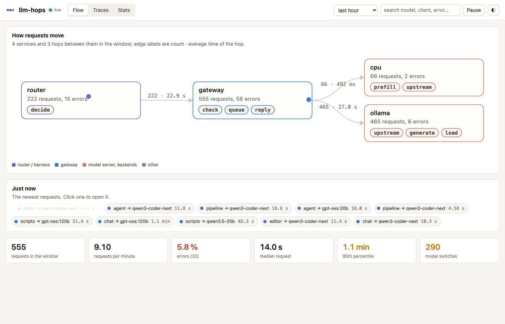
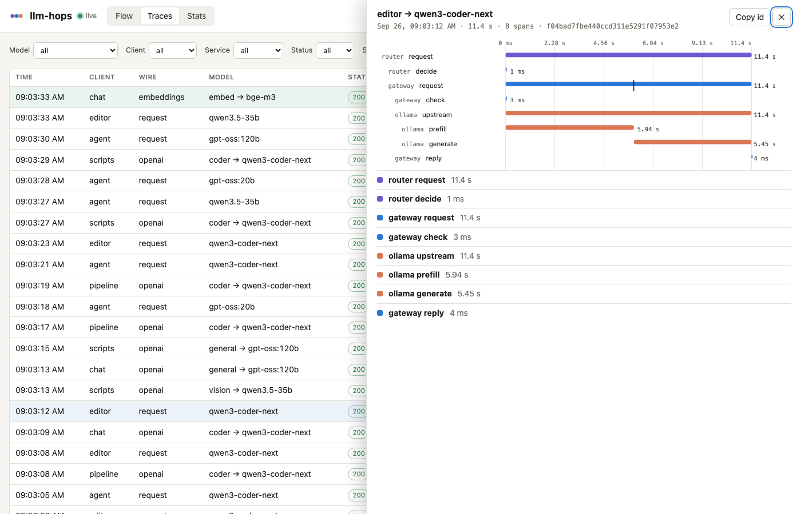

# llm-hops

llm-hops is a free, self-hosted tracing server that shows where the time goes in a request to a local LLM system (router, gateway, queue, model server), for people who run Ollama, llama.cpp or an OpenAI-compatible gateway at home.

**See every hop of a request through your local LLM system.**

A request to a local model rarely takes one step. It passes a router that decides whether it may leave the
machine, a gateway that picks the model and checks the prompt, a queue that waits for the one slot, a model
server that may have to load 50 GB first, then prefill, generation and the reply. When an answer takes 40
seconds instead of one, the question is always the same: *where did the time go?*

llm-hops answers it. One static binary keeps the traces in a SQLite file and serves a page with three views:

- **Flow**: the services in your system and the hops between them, with the live requests travelling along
  the edges as they happen, and the newest requests as chips you can open.
- **Traces**: every request in the window, filterable by model, client, service, status and duration, with
  queue time, time to first token, total, tokens and tokens per second. Click one for its **waterfall**: each
  hop as a bar on a time axis, the first-token marker, and every attribute.
- **Stats**: requests per minute, error rate, percentiles per hop ("where the time goes"), per-model rows
  and the number of model switches.

Light and dark. Keyboard: `1` `2` `3` switch views, `/` searches, `j` `k` walk the traces, `Esc` closes,
space pauses the live stream. No build step, no external requests from the page, no prompt text stored.





## Try it in one minute

```bash
go install github.com/YauhenBichel/llm-hops/cmd/llm-hops@latest   # or download a binary from the releases
llm-hops serve -demo 300 -live
```

With Homebrew (the formula is in [the tap](https://github.com/YauhenBichel/homebrew-tap); release binaries for
macOS arm64 and Linux amd64 and arm64 are on the [releases page](https://github.com/YauhenBichel/llm-hops/releases)):

```bash
brew install yauhenbichel/tap/llm-hops
```

Open http://127.0.0.1:11602/. The demo is a small home LLM system: a router on a laptop, a gateway with one
slot, a model server that swaps models and loses its cache, five clients. The data is synthetic.

### The same demo as text

The page is the main thing, but everything it shows is also available as text through the MCP server.
This was captured from `llm-hops serve -demo 300` (on another port, with a temporary database) and
`llm-hops mcp -to http://127.0.0.1:11699`, calling the tools `hops_stats` and `hops_slowest`:

```text
Window: 299 requests, 15 errors, p50 15.2 s, p95 1.0 min, max 1.3 min, 92 model switches.
Where they went:
  cloud  anthropic     25 requests, 0 errors, tokens in 70000 / out 14621, p50 6.0 s, p95 7.1 s
  local  ollama       259 requests, 14 errors, tokens in 1481502 / out 75313, p50 22.5 s, p95 1.0 min
  local  cpu           15 requests, 1 errors, tokens in 5926 / out 0, p50 490 ms, p95 1.1 s
Time per hop (leaf hops, median / p95):
  load       n=135   36.2 s / 54.3 s
  generate   n=244   7.6 s / 17.1 s
  prefill    n=267   820 ms / 10.2 s
  upstream   n=25    6.0 s / 7.1 s
  queue      n=73    482 ms / 2.1 s
  reply      n=267   3 ms / 5 ms
  check      n=274   2 ms / 3 ms
  decide     n=114   2 ms / 4 ms
```

```text
11-27 08:46:37  router   agent      gpt-oss:120b               ok     1.3 min  first token 54.9 s
11-27 08:35:21  router   agent      gpt-oss:120b               ok     1.3 min  first token 58.1 s
11-27 08:38:48  gateway  pipeline   qwen3-coder-next           error  1.3 min  first token 1.2 min  error=timeout
```

In this synthetic system the answer to "where did the time go?" is the `load` hop: loading a model takes a
median 36 s, far more than prefill or generation.

## When to use it, and when not

Use it when a request to a local model sometimes takes far longer than usual and you want to see which hop
(queue, model load, prefill, generation) caused it, or when several programs share one GPU and you want to see
who made the others wait.

Do not use it as a general tracing backend for web services (use Jaeger or Tempo), as an LLM evaluation or
prompt-management tool (use Langfuse or similar), or to store prompts: it stores none.

## Feed it your system

**From a log you already have.** yllm-gateway writes one JSON line per request with queue, upstream,
first-token and total times. Follow it and every line becomes a trace, no code change:

```bash
llm-hops serve -tail ~/yllm-gateway/var/requests.jsonl -from-start
```

Rotation is survived, a partial line waits for its newline, and the same line never makes two traces.

**Model loads from Ollama's own log.** On the machine that runs Ollama, `-ollama-journal` (or `ollama_journal
= true` in the file) follows `journalctl -u ollama`: every "loading model via llama-server" ... "started in
9.8 seconds" pair becomes a trace of its own, service `ollama`, name `load`, with the model's name (resolved
through Ollama's API), the blob and the seconds. The stats count loads and time loading apart from requests.
`ollama_since = "7 days ago"` reads the history first. This is the picture of "who else is using the GPU".
`llm-hops import FILE` loads a file once; `llm-hops tail FILE -to URL` follows it from another machine.

**From your code.** Spans are JSON; post a list to `POST /api/v1/spans`:

```json
{"trace_id": "5f1c…", "span_id": "a1", "parent_id": null, "service": "gateway", "name": "request",
 "start_ms": 1790409578748, "end_ms": 1790409624115, "status": "ok",
 "attrs": {"client": "editor", "model": "qwen3-coder-next", "queue_ms": 1200, "ttft_ms": 5564}}
```

The Python SDK (standard library only; not on PyPI yet, install it from a clone with
`pip install ./sdk/python`) opens spans with a context manager, posts
them in batches from a background thread, and has a pure ASGI middleware that makes one span per request
and passes the trace id in the W3C `traceparent` header: [sdk/python](sdk/python/README.md).

A span has a `service`, a `name`, a start and an end in milliseconds, a `status` and flat attributes. The
names the page draws with meaning: `decide`, `check`, `queue`, `load`, `prefill`, `generate`, `upstream`,
`reply`. Any other name is drawn as a plain hop.

## Integrations

Three doors other tools already know, all in [docs/integrations.md](docs/integrations.md):

- **OpenTelemetry in**: point any OTel SDK's OTLP HTTP exporter (JSON encoding) at `/v1/traces`; GenAI
  attributes map to the page's names, prompt text is dropped on arrival.
- **Prometheus out**: `/metrics`, the last five minutes per hop and per model.
- **MCP for assistants**: `claude mcp add llm-hops -- llm-hops mcp -to http://127.0.0.1:11602` gives Claude
  Code, Cursor or any MCP client five read-only tools: stats, the slowest requests, a filtered list, one
  request as a text waterfall, the flow.

The HTTP API is described at `/api/openapi.json`.

### MCP tools

`llm-hops mcp` is an MCP server over stdio. All five tools only read from a running `llm-hops serve`; none
changes anything.

| Tool | What it does | Read-only |
|---|---|---|
| `hops_stats` | Request counts, error rate, p50/p95, model switches, time per hop and per model for a window | yes |
| `hops_traces` | The newest requests, filterable by model, client, service, status, minimum duration and free text; at most 100 a call | yes |
| `hops_trace` | One request in full: every hop with timing and attributes, as a text waterfall | yes |
| `hops_slowest` | The slowest requests of the window, with where their time went | yes |
| `hops_flow` | The services seen in the window and the hops between them, with counts and average times | yes |

## Use with other MCP clients (Grok Build, Cursor, any MCP client)

`llm-hops mcp -to <server-url>` speaks MCP over stdio and reads from a running `llm-hops serve`. Any client that
starts a stdio server can use it. In `.mcp.json`, `.cursor/mcp.json` or the client's own server list:

```json
{
  "mcpServers": {
    "llm-hops": {
      "command": "llm-hops",
      "args": ["mcp", "-to", "http://127.0.0.1:11602"],
      "env": { "LLM_HOPS_TOKEN": "<your-token>" }
    }
  }
}
```

Leave `env` out when the server has no `token`. Use the full path to `llm-hops` if the client does not see your `PATH`.

Grok Build (xAI) reads `~/.grok/config.toml`, or `.grok/config.toml` in a project:

```toml
[mcp_servers.llm-hops]
command = "llm-hops"
args = ["mcp", "-to", "http://127.0.0.1:11602"]
env = { LLM_HOPS_TOKEN = "<your-token>" }
```

or in one line: `grok mcp add llm-hops -- llm-hops mcp -to http://127.0.0.1:11602`. Grok Build also reads `.mcp.json`
and `.cursor/mcp.json`, so the JSON above works there too.

Models without MCP support (for example Meta's Muse Spark, whose API offers function calling) can use these tools
through an MCP-to-function-calling bridge; llm-harness provides one, see llm-harness's README.

Tested with Claude Code. The Grok Build block follows xAI's documentation and has not been run.

## The API

| Call | Gives |
|---|---|
| `POST /api/v1/spans` | a list of spans, or `{"spans": [...]}`; answers accepted, rejected, the trace ids touched |
| `GET /api/v1/traces?since&until&limit&offset&sort&count&model&client&service&status&min_ms&q` | trace summaries, newest first; `sort=duration` for slowest first, `count=1` adds the `total` that match |
| `GET /api/v1/traces/{id}?max_spans` | one trace: summary and every span, or its first `max_spans` |
| `GET /api/v1/stats?since&until&bucket_ms` | counts, p50/p95/max, per-hop and per-model rows, requests per bucket, model switches |
| `GET /api/v1/flow?since&until` | the services and the aggregated hops between them |
| `GET /api/v1/facets?since&until` | the values the filters can take |
| `GET /api/v1/stream` | server-sent events: one per trace touched |
| `GET /api/v1/health` | ok, time, database path, uptime |
| `GET /metrics` | Prometheus text: the last five minutes, per hop and per model |

Times are milliseconds since the epoch. Spans older than `keep_days` (14) are rolled up into daily statistics
per model and dropped, at the start and every ten minutes; the stats view shows rolled-up days too, marked approximate.

Limits, so one sender cannot hurt the rest: an id is at most 64 bytes and a longer one is rejected, not
shortened; a span starts no more than a day ahead and lasts at most 24 hours; a trace holds at most
`max_spans_per_trace` spans (5000; more are dropped, and the answer and `llm_hops_spans_dropped_total` say so).
The answer to a `POST` gives the reasons for what it rejected. A span sent again with the same trace and span
id replaces the earlier one. The details are in [docs/deploy.md](docs/deploy.md#limits-and-the-size-of-the-file).

## Running it for real

`llm-hops serve` listens on loopback by default; `llm-hops config` prints a configuration file to start from.
A `token` guards the API and the page when you need more than loopback (`Authorization: Bearer` for senders,
`/#token=…` once for a browser). `llm-hops export` and `import` move a store between machines. A systemd unit and the setup used on the
author's server are in [docs/deploy.md](docs/deploy.md). The SQLite file is written with WAL and
`synchronous=FULL`, so a power cut loses no span that was acknowledged.

What is **not** stored: prompts, completions, keys. What the page shows is what the spans carry, so the rule
is on the sender: [docs/privacy.md](docs/privacy.md).

## Numbers

Measured on 26 September 2026 on a laptop (Apple M-series), `llm-hops bench -rate 10000 -seconds 10` against a
fresh server on the same machine:

| | |
|---|---|
| spans sent | 100,318 in 100 posts over 10.1 s (9,935 spans/s) |
| accepted | 100,318; no post failed; the slowest post took 54 ms |
| server memory after | 33 MB resident |
| the page during the load | answered in 0.5 ms |
| statistics over everything (13,742 traces, 100k spans) | 561 ms |
| database | 30 MB |

## FAQ

### Does it send my data anywhere?

No. The page makes no external requests and the server listens on loopback by default. Prompt and completion
text are not stored; see [docs/privacy.md](docs/privacy.md) for the rule senders must follow.

### How is it different from Langfuse, Jaeger or OpenTelemetry?

It is one binary and one SQLite file with no other services, built around the hops of a local LLM system
(queue, model load, prefill, generation). It accepts OpenTelemetry traces (OTLP over HTTP, JSON encoding) but
is not a replacement for a full tracing backend, and it does not do prompt management or evaluation.

### How do I get traces from Ollama or a gateway without changing code?

Follow a yllm-gateway request log with `-tail`, or Ollama's journal with `-ollama-journal`. See "Feed it your
system" above. Other systems need a small adapter or code that posts spans to `POST /api/v1/spans`.

### Can I ask an assistant about my traces?

Yes. Add the MCP server with
`claude mcp add llm-hops -- llm-hops mcp -to http://127.0.0.1:11602`, then ask "why was my last request slow?".

### How long is data kept?

14 days by default (`keep_days`); older spans become daily statistics. See "The API" above.

## Building

```bash
go build ./cmd/llm-hops           # Go 1.23+, no CGO, the page is embedded
go test -race ./...
cd sdk/python && uv venv && uv pip install -e ".[dev]" && .venv/bin/python -m pytest
```

## Why this exists

The author runs a home LLM server for coding tools and agents. Its worst days were explained only after the
fact, by reading a request log line by line: a queue that waited for the wrong model, a cache lost by a
program that unloaded the model once a minute, a prompt that was cut silently. The numbers were there; the
picture was not. llm-hops is the picture. The system it was built for is described in
[yserver-local-llm-system](https://github.com/YauhenBichel/yserver-local-llm-system).

## Where it is going

Seven milestones, each task with its "done when", in [docs/ROADMAP.md](docs/ROADMAP.md); the tasks are the
issues with a milestone label. The two that open the door to other systems come first: an OpenTelemetry
receiver and a proxy mode that needs no log at all.

## Licence

Apache-2.0. Contributions are welcome; see [CONTRIBUTING.md](CONTRIBUTING.md).
